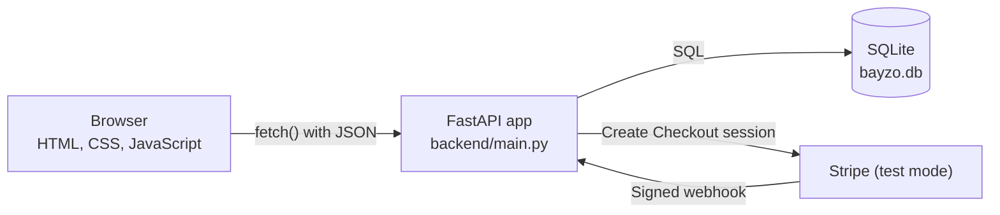
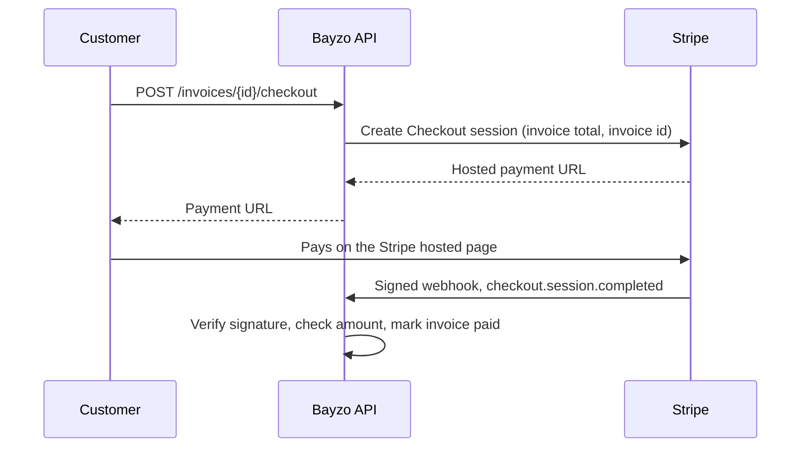

# Bayzo

A full-stack booking and invoicing app for a fictional self-service garage, where car owners rent a bay, use professional tools, and get help from a mechanic.

Bayzo is a learning and portfolio project. The garage is imaginary, and all payments run in Stripe **test mode**, so no real money is ever involved.

## What it does

- Customers browse services and prices, which are loaded live from the database.
- Customers book a bay by date, start time, and duration. The API prevents double bookings, even when two requests arrive at the same moment.
- When a booking is completed, the API generates an invoice with the subtotal, tax, and total.
- Customers pay the invoice through Stripe Checkout. A signed webhook from Stripe marks the invoice as paid.

## Tech stack

| Layer | Technology |
|---|---|
| Front end | HTML, CSS, and vanilla JavaScript (`fetch`) |
| API | Python with FastAPI and Pydantic |
| Database | SQLite, accessed with plain SQL |
| Payments | Stripe Checkout and webhooks (test mode) |
| Tooling | Git and GitHub, the Stripe CLI for local webhooks |

## Architecture



The browser never touches the database. The API is the only component that reads or writes data, and the two communicate only through JSON over HTTP.

### Payment flow



Card details never reach the Bayzo server. The webhook, not the customer returning to a success page, is what marks an invoice as paid, because anyone could open a success URL by hand.

## Project structure

```
bayzo/
├── index.html          Home page with the service cards
├── pricing.html        Pricing page, loaded from the API
├── book.html           Booking form
├── style.css           Shared styles
├── pricing.js          Fetches services and builds the price cards
├── book.js             Loads form options and submits bookings
├── .gitignore
└── backend/
    ├── main.py         FastAPI app: endpoints, validation, Stripe integration
    └── database.py     SQLite connection, schema, and starting data
```

## Data model

- **services**: id, name, price, unit, description
- **bays**: id, name
- **bookings**: customer name and email, service id, bay id, date, start hour, duration, status (`booked` or `completed`)
- **invoices**: booking id (unique), description, subtotal, tax, and total in cents, status (`unpaid` or `paid`), created timestamp

## API reference

Interactive documentation is available at `http://127.0.0.1:8000/docs` while the API is running.

| Method | Path | Purpose | Status codes |
|---|---|---|---|
| GET | `/services` | List services | 200 |
| GET | `/services/{id}` | Get one service | 200, 404 |
| GET | `/bays` | List bays | 200 |
| POST | `/bookings` | Create a booking | 201, 400, 404, 409, 422 |
| GET | `/bookings` | List bookings | 200 |
| POST | `/bookings/{id}/complete` | Complete a booking and create its invoice | 201, 404, 409 |
| GET | `/invoices` | List invoices | 200 |
| GET | `/invoices/{id}` | Get one invoice | 200, 404 |
| POST | `/invoices/{id}/checkout` | Create a Stripe Checkout session | 200, 404, 409, 502 |
| POST | `/webhooks/stripe` | Receive Stripe events | 200, 400, 500 |

## Running it locally

### Prerequisites

- Python 3.9 or newer
- Git
- A free [Stripe](https://stripe.com) account, used in test mode
- The [Stripe CLI](https://docs.stripe.com/stripe-cli), which forwards webhooks to your computer

### 1. Clone and set up the backend

```
git clone https://github.com/<your-username>/bayzo.git
cd bayzo/backend
python3 -m venv venv
source venv/bin/activate
pip install "fastapi[standard]" stripe python-dotenv
```

On Windows, activate the environment with `venv\Scripts\activate` instead.

### 2. Add your settings

Create `backend/.env` with your Stripe **test** keys. This file is ignored by Git and must never be committed.

```
STRIPE_SECRET_KEY=sk_test_your_key_here
STRIPE_WEBHOOK_SECRET=whsec_from_the_stripe_cli
SITE_URL=http://127.0.0.1:5500
```

Find the secret key in the Stripe Dashboard under **Developers > API keys**, in test mode.

### 3. Start the three processes

Use a separate terminal for each.

**Stripe CLI** (start this first):

```
stripe login
stripe listen --events checkout.session.completed,checkout.session.async_payment_succeeded --forward-to localhost:8000/webhooks/stripe
```

Copy the `whsec_...` signing secret it prints into `STRIPE_WEBHOOK_SECRET` in `backend/.env`. The CLI can print a different secret each time it runs, so compare it with your `.env` every time.

**API** (from `backend/`, with the virtual environment active):

```
fastapi dev main.py
```

The SQLite database (`bayzo.db`) is created and filled with starting services and bays on the first run. Delete the file and restart to reset it.

**Website** (from the project root):

```
python3 -m http.server 5500
```

Then open `http://127.0.0.1:5500/index.html`.

## Try it: book, invoice, and pay

1. Open the **Book** page and reserve a bay, for example Guided Bay, Bay 1, a future date, 10:00 AM, 3 hours.
2. Book the same bay at 11:00 AM to see the **409 conflict** message.
3. Open `http://127.0.0.1:8000/docs` and run `POST /bookings/{id}/complete` with your booking number. A 3-hour Guided Bay booking produces a $135.00 subtotal, $6.75 tax, and a $141.75 total.
4. Run `POST /invoices/{id}/checkout` and open the returned `url`.
5. Pay with the Stripe test card `4242 4242 4242 4242`, any future expiry date, and any 3-digit security code.
6. Run `GET /invoices/{id}`. The status is now `paid`, set by the verified webhook.

## Design decisions

- **Money is stored as integer cents.** Floating-point decimals are approximate (`0.1 + 0.2` is `0.30000000000000004`), and Stripe also uses the smallest currency unit.
- **Invoices store a snapshot of their amounts.** Changing a service price later does not alter past invoices.
- **Double bookings are prevented inside a transaction.** The overlap check and the insert run under a database write lock (`BEGIN IMMEDIATE`), so two simultaneous requests cannot both pass the check. Back-to-back bookings are allowed.
- **Totals are calculated on the server.** The client never sends prices or amounts.
- **A booking's completion and its invoice are one transaction.** Either both happen or neither does, and a unique constraint allows only one invoice per booking.
- **SQL uses parameter placeholders,** which prevents SQL injection. The front end writes API data with `textContent` to avoid cross-site scripting.
- **Status codes carry meaning.** 201 for created, 400 for a booking past closing time, 404 for missing records, 409 for conflicts, and 422 for invalid input.
- **The webhook handler is hardened.** It verifies Stripe's signature over the raw request body, checks that the amount paid matches the invoice, and updates only invoices that are still unpaid, so repeated deliveries of the same event are harmless.
- **CORS lists specific origins** instead of allowing every site.
- **Secrets live in `.env`,** which is excluded from Git.

## Known limitations and roadmap

- [ ] Authentication and authorization, with customer and staff roles
- [ ] A web interface for invoices and payment (these currently run through the API docs page)
- [ ] Automated tests for booking rules, invoice amounts, and webhook handling
- [ ] PostgreSQL and tracked database migrations instead of resetting the SQLite file
- [ ] Hosting the API online, so the deployed front end can reach it
- [ ] Reject past dates in the API, not only in the form
- [ ] Model Specialty Tools (a daily rental) in the booking system

## Author

Built by Sarwat as a hands-on way to learn full-stack development.

